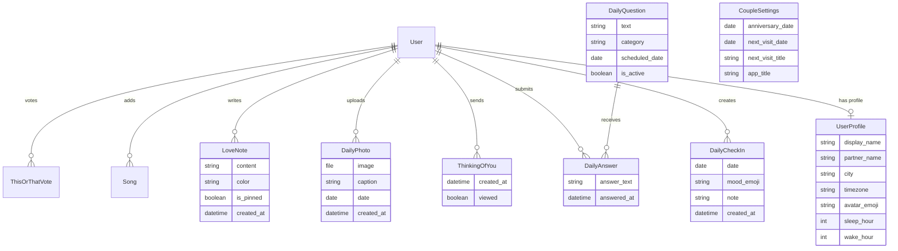

# 💖 Our Space — Implementation Plan & Data Models

A warm, private, mobile-first web app built for Jojo and Jay to share their days across the miles.

---

## 1. System Architecture & Tech Stack

```
+-------------------------------------------------------------+
|                        Client Layer                         |
|   Mobile-First Web UI (HTML5, Vanilla CSS3, Vanilla JS)     |
|   - Soft romantic theme: Warm Pinks, Cream, Deep Plum       |
|   - Native Dark Mode support & Mobile Bottom Navigation     |
|   - Heart tap animations, local time live clocks            |
+-------------------------------------------------------------+
                              |
                              v
+-------------------------------------------------------------+
|                      Django 5.2 (Python)                    |
|   - Strict Authentication (Jojo & Jay only, no signup)      |
|   - Zoneinfo-based timezone calculations & awake status     |
|   - Mutual-reveal logic for Question of the Day             |
|   - Media upload management for Photo of the Day            |
+-------------------------------------------------------------+
                              |
                              v
+-------------------------------------------------------------+
|                      Storage Layer                          |
|   - SQLite (zero configuration, easily backupable)          |
|   - Media root for photos & avatars                         |
+-------------------------------------------------------------+
```

---

## 2. Data Models (ER Diagram & Schema)



### Model Specifications

1. **`UserProfile`**
   - Linked 1-to-1 with Django's `User` model.
   - Stores `display_name` ("Jojo", "Jay"), `city` (e.g. "Kampala", "London"), IANA `timezone` (e.g. `Africa/Kampala`, `Europe/London`).
   - Stores `sleep_hour` (default 23 / 11 PM) and `wake_hour` (default 7 / 7 AM).
   - Helper methods:
     - `get_local_datetime()`: converts UTC `now()` to the user's local time.
     - `is_probably_awake()`: returns `True` if local time hour is between wake and sleep hours.
     - `status_message()`: e.g. "Jay is probably sleeping 🌙" or "Jojo is up and about ☀️".

2. **`CoupleSettings`** (Singleton)
   - `anniversary_date`: Starting date of their relationship.
   - `next_visit_date`: Date of the next visit.
   - `next_visit_title`: e.g., "London hugs" or "Next reunion".
   - Helper methods:
     - `days_together()`: Days elapsed since anniversary.
     - `days_until_visit()`: Days remaining until next visit.

3. **`DailyCheckIn`**
   - Fields: `user`, `date` (defaults to today), `mood_emoji` (🥰, ☕, 😴, 🥳, 🌧️, ✨, etc.), `note` ("Today I...").
   - Unique together on `(user, date)` so each partner checks in once per day (or updates their note).

4. **`ThinkingOfYou`**
   - Fields: `sender`, `receiver`, `created_at`, `viewed`.
   - When tapped, records the instant. When the partner loads any page, an animated floating heart notification pops up: *"Jay was thinking of you at 3:42 PM 💕"*.

5. **`DailyQuestion` & `DailyAnswer`**
   - `DailyQuestion`: Seeded with 65+ thoughtful, playful, and romantic questions. Rotates daily based on day count.
   - `DailyAnswer`: Linked to question & user.
   - **Double-Blind Reveal Logic**: In the view, the partner's answer is only included in context if `DailyAnswer.objects.filter(question=q).count() == 2`. If only one person has answered, it displays *"Jay has answered! Answer to reveal both 💌"*.

6. **`DailyPhoto`**
   - Fields: `user`, `image`, `caption`, `date`, `created_at`.
   - Displayed in a warm Polaroid-style timeline.

7. **`LoveNote`**
   - Fields: `author`, `content`, `color` (rose, blush, cream, lavender, peach), `is_pinned`, `created_at`.
   - Pinned notes stay at the top of the board; unpinned notes cascade below.

8. **Fun Extras**:
   - `Milestone`: Key moments in their relationship history.
   - `Song`: Shared playlist items (title, artist, link, note on why it matters).
   - `ThisOrThatQuestion` & `ThisOrThatVote`: Quick binary choices (e.g., "Early morning flight" vs "Late night drive").

---

## 3. Visual & UX Design

- **Color Palette**:
  - Primary Blush / Warm Pink: `#E07A86` / `#F7C5CC`
  - Cream Background: `#FFFBF7`
  - Deep Plum Accent: `#4A1525`
  - Warm Card Background: `#FFFFFF`
  - Dark Mode: Deep cozy plum background (`#1C1017`), muted rose cards (`#2D1B25`), soft text (`#F5E6EC`).
- **Typography**: Clean system serif/sans blend (Georgia / Inter / Nunito feel) with warm friendly rounded pill badges (`border-radius: 18px-24px`).
- **Mobile First**: Fixed bottom navigation bar for quick one-thumb switching between `Our Day`, `Questions`, `Photos`, and `Love Notes`.

---

## 4. Phased Implementation Roadmap

### **Step 1: Project Setup, Authentication, Dashboard & Daily Check-In** (COMPLETED)
1. Initialize Django project and `core` app with settings (timezones, static, media).
2. Create base models (`UserProfile`, `CoupleSettings`, `DailyCheckIn`, `ThinkingOfYou`).
3. Create `setup_our_space` management command to create Jojo and Jay users with starter credentials and default settings.
4. Build the login page (styled, no sign-up link).
5. Build the "Our Day" dashboard:
   - Side-by-side time cards with live local time and awake/asleep indicators.
   - Days together counter & next visit countdown (with inline edit modal).
   - "Thinking of You" button with instant feedback and popup alert for the other person.
   - Daily Check-in widget: pick an emoji, write a note, see partner's latest note with timestamp.
6. Verify locally with automated tests (all 6 tests passing).

### **Step 2: Question of the Day & Photo of the Day**
1. Implement `DailyQuestion` and `DailyAnswer` models with seed data generator (65+ questions).
2. Build Question of the Day UI with the mutual reveal privacy mechanic.
3. Implement `DailyPhoto` upload with client-side image preview and Polaroid-style shared timeline.
4. Verify photo uploads, media serving, and answer privacy in browser.

### **Step 3: Love Notes Board & Fun Extras**
1. Implement Love Notes wall (sticky note styling, pin/unpin, color choices).
2. Add shared playlist and milestone memories timeline.
3. Add subtle animations (floating heart particles on button tap, smooth card transitions).
4. Full dark mode toggle with persistent local storage.

### **Step 4: Quality Assurance, Automated Tests & Deployment Guide**
1. Write Django test suite covering:
   - Private access restrictions (unauthenticated redirects to login).
   - Timezone calculations and awake status logic.
   - Question of the day double-blind privacy filter.
   - Check-in creation and update.
2. Produce comprehensive `README.md` with:
   - Local setup guide (venv, runserver, seed command).
   - One-click / step-by-step free deployment guide for **Render** and **PythonAnywhere**.
   - Instructions on how Jojo and Jay can change their cities, timezones, and passwords.
